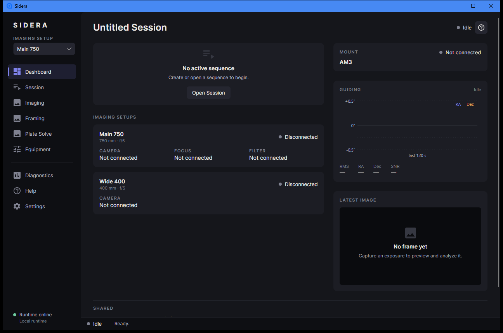
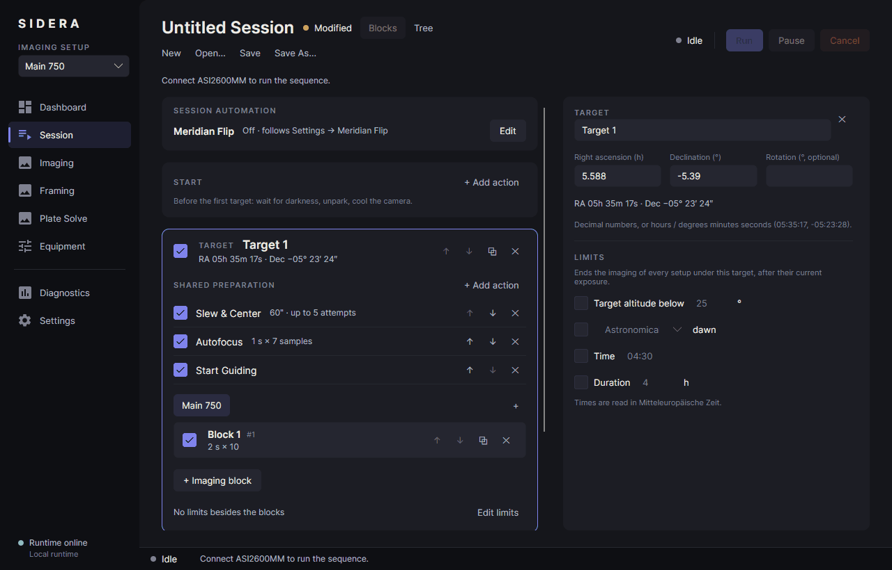
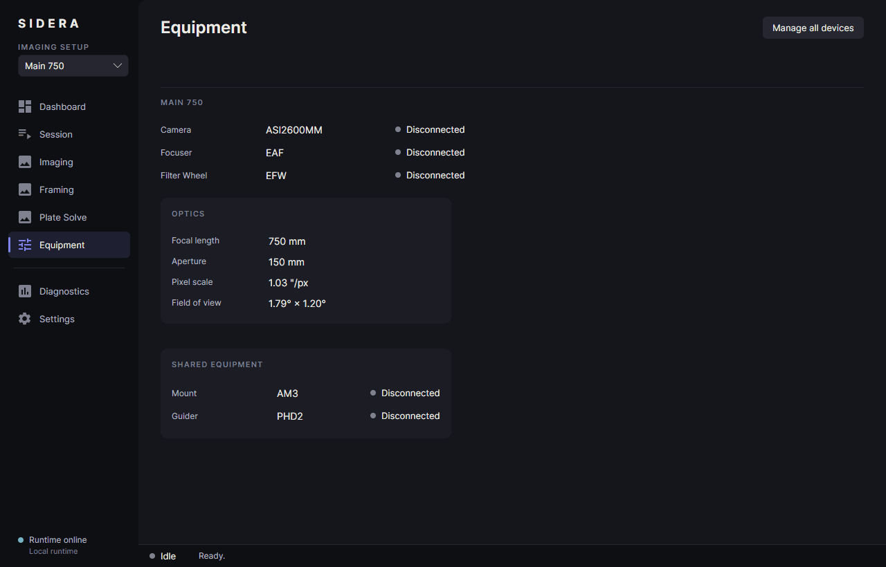

> # ⚠️ In development — not reliable for astro sessions
>
> **Sidera is an early, unfinished project. Do not rely on it for a night of imaging, and never leave real equipment running unattended.**
> You are welcome to try it on your own initiative and **at your own risk**: it can move a real mount, rotator, focuser and dome, and most of that has only been tested against simulators.
> See [what has been tested on real hardware](docs/hardware-status.md).

<p align="center">
  
</p>

<p align="center">
  Astrophotography sequencing for Windows, built around multi-camera imaging, automation and a fast workflow.
</p>



## What it is

Sidera runs imaging sessions across one or more imaging setups and coordinates the devices they share (mount, guider, dome). It works with the ASCOM Platform for real equipment, ASCOM Alpaca for domes and
roll-off roofs, PHD2 for guiding, ASTAP for plate solving, and with built-in simulators so that you can try everything without hardware.

| Session | Equipment |
|---|---|
|  |  |

## What it does

- **Sessions:** targets with their shared preparation (Slew & Center, Autofocus, Start Guiding), imaging blocks per setup, automation (dither, autofocus, meridian flip) and limits. Also as an explicit tree of steps.
- **Imaging setups:** several cameras at once, each with its own focuser, filter wheel and rotator, sharing one mount and one guider. Sidera works out who may do what at the same time.
- **Meridian flip** by the hour angle of the target, with centering, guiding restart and failure handling.
- **Autofocus** that searches for the focus, remembers where it was, and does not give up on a blurred sample.
- **Plate solving, Slew & Center, framing** on a sky survey, rotator calibration and Center & Rotate.
- **Saving frames** as FITS with a name and folder pattern of your choice and a proper header.
- **Dashboard** with the state of the setups, the mount (position, pier side, meridian), guiding and the latest image.
- **Domes and roll-off roofs** over ASCOM Alpaca, as devices and as sequence actions.
- **Messages, themes** (including a dark-red one for the telescope) and a built-in **Help Center**.

## Status

Sidera is under active development. Read [Status and what has been tested](docs/hardware-status.md) before you connect anything that moves.
The short version: the camera and the focuser have been used on real hardware, a first real meridian flip has been done on one ASCOM mount, and everything else (guiding, dither, dome, filter wheel, autofocus on real stars)
is tested against simulators and fakes only.

## Get it running

Requirements: Windows 10 or 11, the [.NET 10 SDK](https://dotnet.microsoft.com/download); for real equipment the [ASCOM Platform](https://ascom-standards.org/) 7 and the drivers of your devices.

```bash
git clone https://github.com/brendlij/sidera.git
cd sidera
dotnet run --project src/Sidera.Desktop
```

Without devices, open **Equipment** and add the simulated demo equipment to try everything. There is no installer yet; [Getting started](docs/getting-started.md) also shows how to publish a folder you can copy to another PC.

## Documentation

| | |
|---|---|
| [Getting started](docs/getting-started.md) | From the first start to a first session on the simulators |
| [Status and hardware tests](docs/hardware-status.md) | What is verified, what is not, how to test safely |
| [Dashboard](docs/dashboard.md) | What the dashboard shows and how to change it |
| [Saving frames](docs/saving-frames.md) | Folders, file names, the FITS header |
| [Autofocus](docs/autofocus.md) | How the search works and its settings |
| [Meridian flip](docs/meridian-flip.md) | The flip, its safeguards and how to check it |
| [Troubleshooting](docs/troubleshooting.md) | Problem, likely reason, what to check |
| [Feature reference](docs/reference.md) | Everything in one long page |
| [Development](docs/development.md) | Build, test, repository layout, environment variables |

There is also a **Help** entry in the application itself (above Settings) with the same guidance, pictures of the real pages and a **?** on every page.

## Contributing and bugs

Issues and ideas are welcome on GitHub. A bug report is most useful with the log of the session (`%LOCALAPPDATA%\Sidera\logs`, the Diagnostics page opens the folder), the version shown there, and what you expected.
Please say whether it happened with a simulator or with real equipment. See [Development](docs/development.md) for how to build and run the tests.

## License

GNU General Public License v3.0, see [LICENSE](LICENSE). There is no warranty of any kind.
