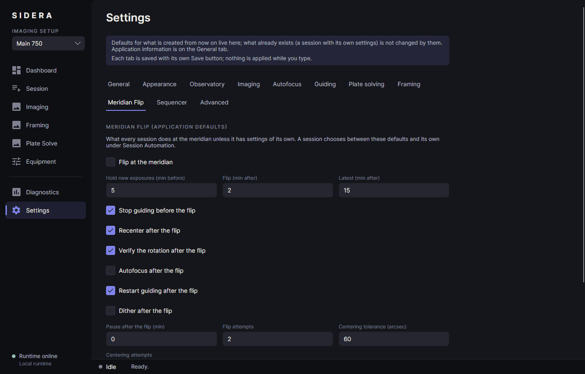

# Meridian flip

> A first real flip has been done on one real mount. The safeguards described below were added afterwards and have only been tested against simulators. **Do not leave a flip unattended**, and know the meridian limits of your mount.

A German-equatorial mount tracks past the meridian up to a limit and then has to turn over. Sidera does it for you, once for every setup on the mount.

## Setting it up

1. **Settings → Observatory**: your site (or a mount that reports one). The flip works out the hour angle of the target from the site and the clock.
2. **Session → Session Automation → Edit** (or the defaults under **Settings → Meridian Flip**): switch the flip on and set, in minutes from the moment the target is on the meridian:
   - **Hold new exposures before** (default 5): from then on an exposure only starts when it ends before the flip is due.
   - **Flip after** (default 2): when the flip is due, once every setup of the mount is at a safe point.
   - **Latest allowed flip** (default 15): after that the failure behaviour applies.
3. Choose what happens after the flip: stop and restart guiding, **recenter**, verify the rotation, autofocus, dither, pause. And whether a failed flip **holds** the mount until you retry or abort, or ends the session.
4. The mount must be assigned to the imaging setup (Equipment → Imaging Setups); otherwise the session says *The meridian flip needs a setup with a mount*.

The dashboard and the session page show the countdown (*Meridian: 36:01 until the hold · 41:01 until the crossing*) and, during the flip, what it is doing.

## What a flip does

Stop guiding → slew to the **same target** (the driver chooses the pier side) → check → plate solve and **center** → verify the rotation → autofocus → restart guiding and wait until it settles → dither → pause. What is switched off is left out. The mount is never synchronized.

## Safeguards

- **The pier side has to change.** If the mount reports the same side before and after the slew, it did not flip (many mounts keep tracking past the meridian and do not turn for a slew to the same place). That is a failure with its reason; check the pier-side and meridian-limit settings of the mount.
- **A flip that failed before the mount changed sides stops its tracking**, so that it does not track on into its limits, and says so. A mount that did change sides stands on the safe side and keeps tracking. A flip that is overdue stops the tracking too.
- **A retry** starts the tracking again and goes on from where the centering had got to, instead of starting again from the uncorrected target.
- **Centering after the flip** lets the mount settle after a slew, tries a solve that found nothing twice more with a new exposure, and starts tracking when the mount says it is not tracking (a frame without tracking cannot be solved).
- A failed flip is an **error message** with a button to the session, and the session shows **Retry the flip** and **Abort the session**.
- The target position is brought from J2000 to the date before the hour angle is worked out (about 80 seconds of time for a target of today), so the countdown agrees with a planetarium.

## Check it before you rely on it

1. Compare the countdown with a planetarium: set your site, find the target and read its hour angle or transit time. They should agree within a minute.
2. Run a session on the **simulator** with the flip on to see the sequence.
3. With a real mount, run a short session with a target a few minutes before the meridian, **stand at the telescope**, and watch the **Side of pier** on the Equipment page change. Look at the log (`MeridianFlipSlew`, `MeridianFlipMountCompleted`).
4. Know the meridian limits and the auto-flip setting of your mount's own firmware or software. Two systems flipping at once, or a limit smaller than your flip time, is the most likely cause of trouble. On OnStep: switch the auto-flip off, set the preferred pier side to *best*, and set the limits past your flip time.

## Limits

The mount's pointing after a flip is only as good as its alignment: on the side of the pier you did not align on, it can be a degree off, and centering has to correct that (it converged in 2 to 3 attempts on the mount it was tested with). Polar alignment and a pointing model make a large difference.
